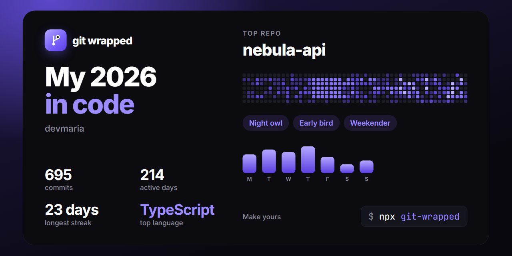

<div align="center">

# git wrapped

**Tu año en git, en un video de 18 segundos.**

Un solo comando lee tu historial de commits y genera un MP4 para compartir al estilo Wrapped: tus repos top, tus lenguajes, tus moods de programación, tu gráfica de contribuciones, tu racha más larga, tu hora pico y más. Con banda sonora propia.

[](https://www.npmjs.com/package/git-wrapped)
[](https://github.com/0scar07/git-wrapped/actions/workflows/ci.yml)
[](LICENSE)
[](https://nodejs.org)

[English](README.md)


<sub>Datos de ejemplo. El video completo con sonido está en <a href="https://github.com/0scar07/git-wrapped/releases">Releases</a>.</sub>

</div>

## Empieza

```bash
npx git-wrapped
```

Ejecútalo dentro de cualquier repositorio de git. El video se guarda como `git-wrapped-<año>.mp4`.

¿Tienes varios proyectos? Apúntalo a la carpeta que los contiene:

```bash
npx git-wrapped --scan ~/code
```

**Tu código nunca sale de tu computadora.** Solo se lee `git log` en local. No se sube nada y no hace falta cuenta ni token.

**Requisitos:** Node.js 18.17+ y git. La primera vez se descarga un Chrome sin interfaz para renderizar (una sola vez).

## Qué sale en el video

| Tiempo | Escena |
|---|---|
| 0–1.5 s | Intro: *Tu 2026 en código* |
| 1.5–3.2 s | Tus 3 repos más activos (o carpetas, si pasas un solo repo) |
| 3.2–4.9 s | Tus 4 lenguajes top y luego tus moods |
| 4.9–8.3 s | Tu repo estrella: commits, días activos y líneas añadidas |
| 8.3–9.8 s | Tu gráfica de contribuciones, con zoom |
| 9.8–11.2 s | *Este fue tu ritmo*, con tu racha más larga |
| 11.2–12.5 s | Commits por día de la semana |
| 12.5–14 s | Archivo más reescrito, hora pico, commit más grande y tu mejor día |
| 14–18 s | Cierre |

Los **moods** salen de tu historial: Nocturno, Madrugador, Fin de semana, Refactor, Cazabugs, Documentador, Tester, Maratonista y Constructor.

## Opciones

| Opción | Qué hace |
|---|---|
| `--scan <carpeta>` | Busca repos de git dentro de una carpeta (2 niveles) |
| `--year <aaaa>` | Año a analizar (por defecto, el actual) |
| `--author <email>` | Tu email de git. Repítelo si usaste varios (por defecto, `git config user.email`) |
| `--name <texto>` | Nombre que se muestra en el video |
| `--lang es\|en` | Idioma del video (por defecto, el de tu sistema) |
| `--music <archivo>` | Tu propia música (mp3 o wav) en vez de la incluida |
| `--no-music` | Video sin audio |
| `--vertical` | Video vertical 9:16 para TikTok, Reels y Shorts |
| `--no-card` | No generar la imagen resumen PNG |
| `--fps 30\|60` | Fotogramas por segundo (30 por defecto; 60 es más fluido y tarda el doble) |
| `--blur` | Desenfoque de movimiento con 4 subfotogramas (unas 4 veces más lento) |
| `--hq` | Máxima calidad: 60 fps + desenfoque de movimiento |
| `--gl <modo>` | Renderizado de Chrome: `angle` (GPU, por defecto en Windows y macOS), `swangle`, `default` |
| `-o, --out <archivo>` | Archivo de salida |
| `--json` | Solo imprime los datos, sin renderizar |
| `--data <archivo>` | Renderiza desde un JSON guardado (puedes editarlo antes) |
| `--demo` | Renderiza con datos de ejemplo |

Junto a cada video también obtienes:

- **Una imagen resumen** (`.png`) lista para X o LinkedIn:

  

- **Los datos** (`.json`), para cambiar un nombre y volver a renderizar con `--data`.

### Para TikTok, Reels y Shorts

```bash
npx git-wrapped --vertical
```

Las mismas escenas, acomodadas para una pantalla de 1080×1920.

### ¿Cuánto tarda?

Unos 2 minutos con las opciones por defecto en una laptop modesta (Ryzen 3 de 4 hilos), menos en un equipo más rápido. `--hq` tarda unas 3 veces más.

## Compártelo

Publica tu video con **#GitWrapped**. Ver el año de los demás es la mitad de la gracia.

## Desarrollo

```bash
npm install
npm run studio   # preview en vivo en Remotion Studio con los datos de ejemplo
npm run demo     # renderiza el video de ejemplo
npm run music    # vuelve a generar la banda sonora (necesita ffmpeg)
npm test         # tests del analizador
```

Hecho con [Remotion](https://www.remotion.dev). Cada fotograma es una función pura del tiempo, así que los renders son deterministas.

La banda sonora es original: una pista de 120 BPM y sus efectos se sintetizan desde cero con [`scripts/make-music.mjs`](scripts/make-music.mjs), sincronizados con las escenas, y van con la misma licencia MIT.

Las contribuciones son bienvenidas: escenas nuevas, moods, lenguajes o traducciones. Mira [CONTRIBUTING.md](CONTRIBUTING.md).

## Créditos

La coreografía está inspirada en el prompt de motion graphics *wrapped* de **@itskeo5**.

Sin relación con Spotify ni con GitHub.

## Licencia

[MIT](LICENSE)
