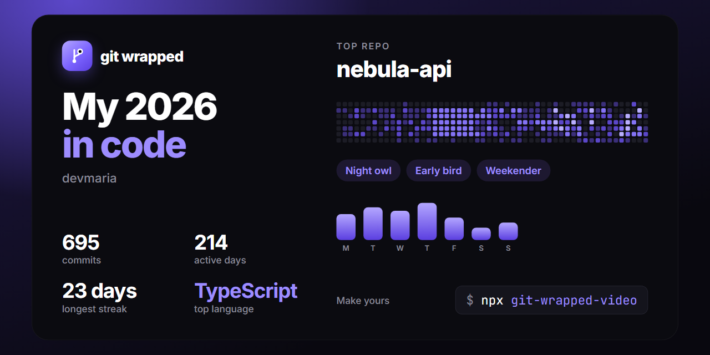

<div align="center">

# git wrapped

**Your year in git, as an 18-second video.**

One command reads your commit history and renders a shareable Wrapped-style MP4: your top repos, languages, coding moods, contribution graph, longest streak, peak hour and more. With its own soundtrack.

[](https://www.npmjs.com/package/git-wrapped-video)
[](https://github.com/0scar07/git-wrapped/actions/workflows/ci.yml)
[](LICENSE)
[](https://nodejs.org)

[Español](README.es.md)


<sub>Sample data. Grab the full video with sound in <a href="https://github.com/0scar07/git-wrapped/releases">Releases</a>.</sub>

</div>

## Quick start

```bash
npx git-wrapped-video
```

Run it inside any git repository. The video is saved as `git-wrapped-<year>.mp4`.

Got several projects? Point it at the folder that holds them:

```bash
npx git-wrapped-video --scan ~/code
```

Use it often? Install it once with `npm i -g git-wrapped-video` and run `git-wrapped` from anywhere.

**Your code never leaves your machine.** It only reads `git log` locally. Nothing is uploaded, and no account or token is needed.

**Requirements:** Node.js 18.17+ and git. The first run takes a couple of minutes: npx installs the renderer and downloads a headless Chrome (only once).

## What's in the video

| Time | Scene |
|---|---|
| 0–1.5 s | Intro: *Your 2026 in code* |
| 1.5–3.2 s | Your 3 most active repos (or folders, if you pass a single repo) |
| 3.2–4.9 s | Top 4 languages, then your coding moods |
| 4.9–8.3 s | Your top repo: commits, active days, lines added |
| 8.3–9.8 s | Your contribution graph, with a deep zoom |
| 9.8–11.2 s | *This was your rhythm*, with your longest streak |
| 11.2–12.5 s | Commits per day of the week |
| 12.5–14 s | Most rewritten file, peak hour, biggest commit, best day |
| 14–18 s | Closing card |

**Moods** are picked from your history: Night owl, Early bird, Weekender, Refactorer, Bug hunter, Documenter, Tester, Marathoner and Builder.

## Options

| Flag | What it does |
|---|---|
| `--scan <dir>` | Find git repos inside a folder (2 levels deep) |
| `--year <yyyy>` | Year to analyze (default: current year) |
| `--author <email>` | Your git email. Repeat it if you used several (default: `git config user.email`) |
| `--name <text>` | Name shown in the video |
| `--lang es\|en` | Video language (default: your system language) |
| `--music <file>` | Your own music (mp3 or wav) instead of the bundled track |
| `--no-music` | Silent video |
| `--vertical` | Vertical 9:16 video for TikTok, Reels and Shorts |
| `--no-card` | Skip the PNG summary card |
| `--fps 30\|60` | Frame rate (default 30; 60 is smoother and takes twice as long) |
| `--blur` | Motion blur with 4 subframes (about 4x slower) |
| `--hq` | Best quality: 60 fps + motion blur |
| `--gl <mode>` | Chrome rendering: `angle` (GPU, default on Windows and macOS), `swangle`, `default` |
| `-o, --out <file>` | Output file |
| `--json` | Print the computed data and skip rendering |
| `--data <file>` | Render from a saved JSON (edit it first if you want) |
| `--demo` | Render with sample data |

Next to every video you also get:

- **A summary card** (`.png`) ready for X or LinkedIn:

  

- **The data** (`.json`), so you can tweak a name and render again with `--data`.

### For TikTok, Reels and Shorts

```bash
npx git-wrapped-video --vertical
```

Same scenes, laid out for a 1080×1920 screen.

### How long does it take?

About 2 minutes with the defaults on a modest laptop (4-thread Ryzen 3), less on a faster machine. `--hq` takes about 3 times longer.

## Share it

Post your video with **#GitWrapped**. Seeing other people's years is half the fun.

## Development

```bash
npm install
npm run studio   # live preview in Remotion Studio with the sample data
npm run demo     # render the sample video
npm run music    # rebuild the soundtrack (needs ffmpeg)
npm test         # analyzer tests
```

Built with [Remotion](https://www.remotion.dev). Every frame is a pure function of time, so renders are deterministic.

The soundtrack is original: a 120 BPM track and its sound effects are synthesized from scratch by [`scripts/make-music.mjs`](scripts/make-music.mjs), synced to the scenes, and released under the same MIT license.

Contributions are welcome: new scenes, moods, languages or translations. See [CONTRIBUTING.md](CONTRIBUTING.md).

## Credits

The choreography is inspired by the *wrapped* motion-graphics prompt by **@itskeo5**.

Not affiliated with Spotify or GitHub.

## License

[MIT](LICENSE)
